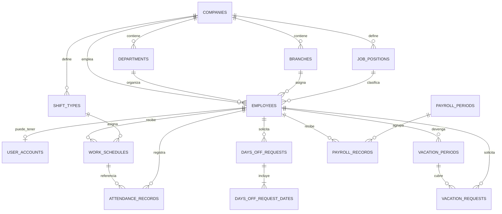

# HRManager

HRManager es un sistema web multiempresa de gestión de Recursos Humanos construido con React y Vite, conectado a Supabase. Reúne páginas públicas, inicio de sesión real y paneles con vistas diferenciadas para administradores, empleadores y empleados: horarios, francos, vacaciones, sueldos, gestión de personal, fichajes, estadísticas y configuración.

## Tecnologías

- React 18 y JSX, Vite 6 y módulos ES.
- Supabase: base de datos PostgreSQL con seguridad por fila (RLS), autenticación, almacenamiento de recibos y funciones de servidor (Edge Functions).
- Tailwind CSS, Inter y Font Awesome cargados desde CDN en `index.html`.
- No hay React Router: las rutas se resuelven en `main.jsx`.

## Puesta en marcha

### 1. Base de datos en Supabase

1. Crear un proyecto en [Supabase](https://supabase.com).
2. En **SQL Editor > New query**, pegar todo `database/schema.sql` y ejecutarlo. Crea las tablas, las políticas RLS, las funciones del motor de reglas y el bucket privado de recibos.
3. En **Authentication > Users > Add user**, crear `empleador@test.com`, `empleado@test.com` y, para el administrador del sistema, `admin@test.com`, marcando **Auto Confirm User**.
4. Ejecutar `database/seed_prueba.sql` en el SQL Editor. Crea "Empresa Test SRL", su empleadora, cuatro empleados de ejemplo, tipos de turno y horarios. `empleado@test.com` queda con contraseña provisoria y `admin@test.com` queda registrado como administrador del sistema.

Las empresas nuevas las da de alta el administrador desde `/admin`. Para registrar otro administrador, crear su usuario en Authentication y ejecutar:

```sql
insert into public.system_admins (auth_user_id, display_name)
select id, 'Nombre del administrador' from auth.users where email = 'email@admin.com';
```

Si el proyecto ya tenía una versión anterior del schema, en lugar de borrar todo alcanza con ejecutar, en orden, `database/actualizacion_fichajes.sql`, `database/actualizacion_admin_notificaciones.sql` y `database/actualizacion_planes_perfil_fichadas.sql`.

**Datos de demostración (opcional).** Después del seed se puede ejecutar `database/datos_demo_anual.sql`: agrega 20 empleados sin cuenta a "Empresa Test SRL" y un año completo de horarios, francos, vacaciones, fichajes y sueldos, para que Estadísticas y los historiales muestren datos. Se puede volver a ejecutar sin duplicar nada. Los recibos de esos sueldos no tienen PDF: al abrirlos el sistema avisa que son de demostración.

### 2. Recuperación de contraseña

En **Authentication > URL Configuration**:

- **Site URL**: la dirección donde se publica el sistema (en desarrollo, `http://localhost:5173`).
- **Redirect URLs**: agregar `http://localhost:5173/nueva-contrasena` y la misma ruta del sitio publicado.

El enlace de recuperación vence a la hora y sirve una sola vez (RNF-11); es la configuración por defecto de Supabase en **Authentication > Providers > Email**.

### 3. Funciones de servidor

Crear usuarios o cambiar su email necesita la clave de servicio, que nunca puede estar en el navegador. Por eso esas operaciones están en `supabase/functions`:

- `create-employee`: alta de un empleado con su cuenta.
- `update-employee-email`: cambio del email de un empleado, que también es su usuario.
- `admin-companies`: alta de empresas y contraseñas provisorias de sus empleadores, para el administrador del sistema.

Para publicarlas, con [Node.js](https://nodejs.org) instalado:

```bash
npx supabase login
npx supabase link --project-ref TU_PROJECT_REF
npx supabase functions deploy create-employee
npx supabase functions deploy update-employee-email
npx supabase functions deploy admin-companies
```

El `project-ref` es el identificador que aparece en la URL del proyecto. Supabase le pasa a la función, sola, la URL y las claves del proyecto.

### 4. Frontend

```bash
cp .env.example .env   # completar con Project Settings > API: Project URL y anon public key
npm install
npm run dev
```

Abrir `http://localhost:5173/login` e ingresar con los usuarios de prueba.

Para compilar: `npm run build` y `npm run preview`.

## Rutas

| Ruta | Contenido |
| --- | --- |
| `/` | Entrada pública (`views/capchat.jsx`) |
| `/home` | Página de inicio |
| `/about` | Información institucional |
| `/price` | Planes y precios |
| `/login` | Inicio de sesión |
| `/login/recover` | Pedido del enlace de recuperación de contraseña |
| `/login/change-password` | Destino del enlace de recuperación: definir una nueva contraseña |
| `/login/change-temporary-password` | Cambio obligatorio de la contraseña provisoria en el primer ingreso |
| `/login` → panel | Con sesión iniciada, lleva al panel que corresponde al rol |
| `/employer` | Panel del empleador |
| `/employer/horarios` | Asignación y consulta de horarios |
| `/employer/francos` | Gestión de solicitudes y asignaciones de francos |
| `/employer/vacaciones` | Gestión de solicitudes de vacaciones |
| `/employer/sueldos` | Gestión de sueldos y recibos |
| `/employer/empleados` | Directorio, alta y edición de empleados |
| `/employer/estadisticas` | Estadísticas de demanda de personal |
| `/employer/fichajes` | Asistencia del día y carga de fichajes |
| `/employer/configuration` | Configuración del empleador |
| `/configuracion` | Alias de configuración del empleador |
| `/employee` | Panel personal del empleado |
| `/employee/horarios` | Consulta personal de horarios |
| `/employee/francos` | Solicitudes y consulta de francos |
| `/employee/vacaciones` | Solicitudes y consulta de vacaciones |
| `/employee/sueldos` | Consulta personal de sueldos |
| `/employee/configuration` | Configuración del empleado |
| `/admin` | Administrador del sistema: tablero con empresas, empleados, facturación y planes |
| `/admin/empresas` | Alta, plan, suspensión y contraseñas de las empresas |
| `/admin/configuracion` | Precios y límites de los planes, nombre y contraseña del administrador |

`main.jsx` exige sesión en las rutas privadas y separa las del administrador, empleador y empleado. La autorización real la hacen las políticas RLS de la base: aunque alguien fuerce una ruta, solo recibe los datos que su rol y su empresa le permiten.

## Distribución de archivos

```text
.
├── AGENTS.md
├── README.md
├── main.jsx                 # rutas, sesión y selección de vistas
├── index.html
├── package.json
├── styles.css
├── components/              # shell, controles, feedback, gráficos y tarjetas
├── data/                    # estructuras, reglas y recursos ilustrativos
├── database/                # esquema, migraciones y datos de prueba
├── hooks/
│   └── usePagination.js
├── lib/                     # API, store, Supabase, navegación y lógica compartida
├── public/                  # imágenes públicas y favicon
├── supabase/functions/      # create-employee, update-employee-email y admin-companies
└── views/
    ├── admin/
    ├── empleado/
    ├── empleador/
    └── participante/
```

### Responsabilidades principales

- `main.jsx`: rutas, control de sesión y rol, cambio obligatorio de contraseña y carga de datos antes de mostrar cada vista.
- `lib/store.js`: consulta a Supabase y deja los datos con la misma forma que tenían los datos de ejemplo, dentro de los objetos de `data/`. Así las vistas conservaron su diseño.
- `lib/api.js`: alta de empleados, horarios, solicitudes, respuestas, sueldos y recibos, fichaje, reglas y contraseñas. Después de cada operación vuelve a cargar los datos.
- `lib/router.js`: navegación sin recarga. Los enlaces internos cambian la dirección con la History API y solo se reemplaza el contenido; los botones Atrás y Adelante del navegador funcionan.
- `components/AppShell.jsx`: marco de las pantallas con sesión. El menú lateral queda montado; en pantallas de menos de 1024 px se abre como cajón desde la barra superior.

### Estadísticas y fichajes del empleador

- `/employer/estadisticas`: turnos asignados, cobertura de horarios de la semana, día de mayor demanda, turnos por franja horaria y solicitudes de vacaciones por mes. Se filtra por departamento y por período. Los gráficos usan Chart.js (`components/ChartCanvas.jsx`).
- `/employer/fichajes`: asistencia de un día con dotación esperada, fichados a tiempo y tarde, francos y ausencias. El empleador carga o corrige la entrada y la salida (función `register_attendance`), ve el historial de cada empleado y puede eliminar un fichaje. Si la salida es anterior a la entrada se toma como del día siguiente (turno noche).
- Los cálculos de qué le toca a cada empleado cada día están en `lib/workforce.js`.
- Si el proyecto de Supabase ya tenía el esquema aplicado, ejecutar las migraciones incrementales indicadas en la sección de puesta en marcha.

### Planes

- Los planes están en la tabla `plans` (Operativo / Pyme, Profesional y Enterprise). El administrador cambia nombre, precio y máximo de empleados desde `/admin/configuracion`.
- Cada empresa tiene un plan (`companies.plan_code`), que se elige al crearla y se cambia desde `/admin/empresas`. No se puede pasar a un plan con menos lugar que los empleados activos.
- La base controla el máximo al dar de alta o reactivar empleados (`employees_limit_guard`). El empleador ve su plan en Configuración.

### Estructura de la empresa

En Configuración el empleador administra puestos, áreas y sucursales: agregar, renombrar, desactivar y eliminar los que no tienen empleados. Lo desactivado deja de ofrecerse en el alta, pero no cambia a quienes ya lo tienen.

### Importar fichajes

En `/employer/fichajes`, **Importar desde Excel** acepta `.xlsx` o `.csv` con las columnas **Legajo**, **Fecha** (DD/MM/AAAA), **Entrada** y **Salida** (HH:MM, 24 horas). La salida es opcional y, si es anterior a la entrada, se toma del día siguiente. El botón **Descargar plantilla** baja un archivo de ejemplo. Antes de importar se muestra una vista previa con los errores de cada fila (legajo inexistente, fecha futura o inválida, hora inválida); solo se importan las filas correctas, hasta 3000 por archivo, y si ya había un fichaje ese día se reemplaza.

### Foto de perfil

Se sube desde Configuración (PNG, JPG o WEBP). El sistema la recorta en cuadrado de 256 px y la guarda en el bucket público `avatars`, en una carpeta por usuario; cada uno solo puede escribir en la suya. Se ve en el menú y en las tablas del empleador.

### Avisos y ventanas de confirmación

Ninguna pantalla usa `alert`, `confirm` ni `prompt` del navegador. Las confirmaciones y los pedidos de datos (por ejemplo, el motivo de un rechazo) usan `confirmDialog` y `promptDialog`, y los resultados se informan con `toast`, todo desde `lib/feedback.js`. `components/FeedbackHost.jsx` los dibuja y está montado una sola vez en `main.jsx`.

### Desplegables

Los paneles no usan el desplegable del navegador. `components/Select.jsx` se usa igual que un `<select>` (con `<option>` adentro, `value`, `onChange`, `name`, `required`) y abre una lista propia del mismo ancho que el campo, con la opción elegida marcada, teclado (flechas, Enter, Escape y letras) y buscador cuando hay más de 8 opciones. Las opciones "Nombre — detalle" muestran el detalle en una segunda línea. `components/SuggestInput.jsx` reemplaza a `<datalist>`: texto libre con sugerencias, como Puesto, Área y Sucursal. El menú de navegación no usa estos componentes.

### Diseño adaptable y tamaño de letra

- Escritorio (1024 px o más): menú lateral fijo. Tablet y celular: barra superior con botón de menú.
- Las páginas públicas agrupan los enlaces en un menú desplegable por debajo de 768 px.
- Todas las medidas están en `rem`, así que escalan juntas con el tamaño base definido en `styles.css`: 112,5 % en general, 118,75 % desde 1440 px y 125 % desde 1800 px. Para agrandar o achicar todo el sistema alcanza con cambiar esos valores.
- Usar `rem` y no `px` en clases nuevas (por ejemplo `text-[0.625rem]` en lugar de `text-[10px]`).
- Las vistas no incluyen el menú lateral: lo pone `AppShell`.
- `views/`: una vista por página, organizada por páginas públicas y por rol.
- `components/`: navegación, identidad de empleados, paginación, formulario de contraseña y tarjetas.
- `data/`: contenedores que se completan con datos reales y helpers de reglas.
- `database/schema.sql`: esquema que se ejecuta en Supabase.
- `supabase/functions/`: Edge Functions `create-employee`, `update-employee-email` y `admin-companies`.

## Seguridad

- Cada empresa ve solo sus datos: todas las tablas tienen políticas RLS y las claves foráneas incluyen la empresa.
- El empleador administra los datos de su empresa; el empleado ve solo los propios. Un empleado no puede ver los sueldos ni los recibos de otro.
- Las contraseñas las maneja Supabase Auth. La base no guarda contraseñas.
- La clave de servicio solo existe en las funciones de servidor.
- Una empresa suspendida por el administrador conserva sus datos, pero ninguna de sus cuentas puede ingresar ni operar.
- Las notificaciones las crea la base con disparadores; cada usuario solo puede leer las suyas y marcarlas como leídas.
- Los recibos se guardan en un bucket privado y se abren con URLs firmadas que vencen a los 5 minutos.
- Las reglas de francos y vacaciones se validan en la base, no solo en la interfaz.

## Límites actuales

- El email de un empleado lo cambia el empleador desde Empleados; el del empleador, por ahora, desde Supabase.
- Las vacaciones se cuentan en días corridos y la antigüedad al 31 de diciembre de cada período. No se contempla el caso de quien trabajó menos de seis meses en el año.

## Base de datos

El esquema está en [`database/schema.sql`](./database/schema.sql) y se ejecuta en el SQL Editor de Supabase.

### Entidades y responsabilidades

| Tabla | Propósito y datos principales |
| --- | --- |
| `companies` | Empresa: razón social y fechas de auditoría. |
| `system_admins` | Administradores de plataforma, separados de las cuentas asociadas a una empresa. |
| `plans` | Planes disponibles, precio mensual, descripción y límite de empleados. |
| `departments` | Departamentos asociados a una empresa. |
| `branches` | Sucursales de la empresa, con dirección opcional. |
| `job_positions` | Puestos o roles laborales disponibles en una empresa. |
| `employees` | Legajo, nombre, email, CUIL, departamento, sucursal, puesto, convenio colectivo, nacimiento, ingreso y estado laboral. |
| `user_accounts` | Cuenta vinculada a Supabase Auth: rol, estado, empleado asociado, nombre visible, contraseña provisoria pendiente y clave de la foto. |
| `shift_types` | Código, nombre, horas de inicio/fin y estado de cada tipo de turno. |
| `business_rules` | Días de franco semanales, anticipación exigida para francos y vacaciones, y si cada tipo de solicitud requiere aprobación. |
| `vacation_entitlement_ranges` | Tramos de antigüedad y días de vacaciones correspondientes. |
| `work_schedules` | Asignación de tipo de turno a un empleado y semana, más una copia histórica del nombre y horario del turno. |
| `attendance_records` | Asistencia por empleado y fecha, con entrada, salida, estado y asignación de horario opcional. |
| `days_off_requests` | Solicitud o asignación de francos, categoría, motivo, estado, resolución y usuarios que intervienen. |
| `days_off_request_dates` | Fechas individuales asociadas a una solicitud de franco, preaviso y marca de franco tomado. |
| `vacation_periods` | Período devengado por empleado y días de vacaciones otorgados. |
| `vacation_requests` | Rango de fechas solicitado, días, estado, período devengado y resolución. |
| `payroll_periods` | Períodos mensuales de liquidación y fecha legal de vencimiento opcional. |
| `payroll_records` | Pago por empleado, período y tipo (sueldo o cuota de aguinaldo): monto neto, estado, fecha de pago y metadatos del recibo PDF. |
| `notifications` | Avisos generados por disparadores para una cuenta; cada destinatario puede leer y marcar los propios. |

### Relaciones



Las claves foráneas compuestas mantienen las relaciones dentro de la misma empresa. Los índices y restricciones de unicidad evitan, entre otros casos, duplicar el legajo o CUIL de una empresa, asignar más de un horario semanal al mismo empleado, repetir una liquidación para el mismo empleado/período o crear más de un tramo abierto de vacaciones por empresa.

### Motor de reglas de negocio

| Función | Qué hace |
| --- | --- |
| `submit_days_off_request` | Solicitud de francos del empleado: valida aviso previo, francos por semana y fechas repetidas; aprueba sola si la empresa no exige aprobación. |
| `assign_days_off` | Asignación directa de francos por el empleador. |
| `submit_vacation_request` | Solicitud de vacaciones: valida aviso previo, superposición y días disponibles. |
| `assign_vacation` | Asignación directa de vacaciones por el empleador, dentro del saldo. |
| `resolve_days_off_request`, `resolve_vacation_request` | Aprobación o rechazo; el rechazo exige motivo. |
| `cancel_my_request` | Cancelación de una solicitud propia pendiente. |
| `vacation_entitlement_days`, `vacation_balance` | Días que corresponden por antigüedad y saldo del período. |
| `clock_in`, `clock_out` | Fichaje con la hora del servidor; marca "late" después de 10 minutos de tolerancia. |
| `set_employee_status` | Activo, en licencia o baja lógica; la baja desactiva la cuenta y conserva el historial. |
| `admin_create_company`, `admin_create_employee` | Operaciones de alta invocadas por las Edge Functions con la clave de servicio. |
| `register_attendance`, `import_attendance` | Registro individual e importación de fichajes; la importación devuelve el resultado por fila. |
| `admin_list_companies`, `admin_set_company_status` | Listado, suspensión y reactivación de empresas para el administrador del sistema. |
| `admin_update_plan`, `admin_set_company_plan`, `admin_dashboard` | Edición y asignación de planes, límites de empleados y métricas del administrador. |
| `admin_update_profile`, `set_my_profile_photo` | Actualización del perfil del administrador y de la foto de perfil del usuario. |
| `mark_password_changed`, `touch_last_login` | Contraseña provisoria reemplazada y último ingreso. |
